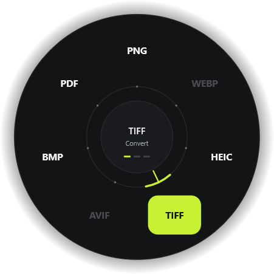
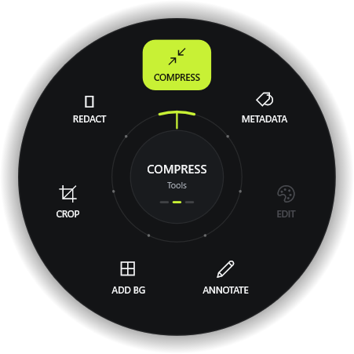
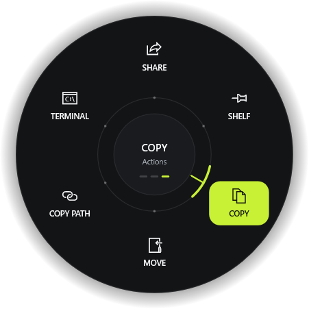

<p align="center">
  
</p>
<h1 align="center">Tau</h1>
<p align="center"><strong>Drag a file. Tap a key. Drop it on the dial.</strong></p>

Tau is a small Windows utility for converting and working with files without opening a separate app. Drag a file, press the wheel key, then drop it on an option. Files stay on your PC, and results are saved beside the originals.

<p align="center">
  
  
  
</p>
<p align="center"><sub>Convert · Tools · Actions — rendered from Tau’s built-in UI preview command.</sub></p>

## What it does

- **Convert** images, audio, video, PDFs, documents, spreadsheets, slides, EPUBs, subtitles, and archives.
- **Use file tools** to compress, crop, redact, annotate, trim, merge, split, and edit supported files.
- **Run file actions** to copy, move, share, copy a path, open a terminal, or collect files on a shelf.
- **Work with batches** where an operation supports multiple selected files.
- **Stay in control:** conversions run locally, a progress window supports cancellation, and existing files are never overwritten.

Tau uses Windows imaging, PDF, OCR, and shell features where available. Some formats and tools need optional software; Tau dims unavailable choices and shows why.

## Use Tau

1. Install Tau and start it. It runs from the system tray.
2. Drag a file (or a selection of files) from File Explorer.
3. Tap **Win** to open the wheel. Scroll during the drag to switch between Convert, Tools, and Actions.
4. Drop the file on the option you want. Tau saves the result beside the source.

For keyboard use, select a file in Explorer and press **Ctrl+Alt+Space** (the default shortcut). Use the arrow keys to choose an option, **Enter** to run it, or **Esc** to close the wheel. Open **Settings** from the tray menu to change the shortcut or assign separate keys to the wheels.

## Formats and optional engines

Tau includes support for common image formats (JPG, PNG, TIFF, BMP, HEIC), PDF, documents, spreadsheets, slides, EPUB, subtitles, and archives. Audio and video conversion, plus WebP and AVIF image conversion, use **ffmpeg**. Put `ffmpeg.exe` on `PATH` or next to `tau.exe` to enable those options; it is not bundled with the installer.

Some document conversions use Microsoft Word, Excel, or PowerPoint, and HTML-to-PDF uses Microsoft Edge. HEIC output depends on the Windows HEIF/HEVC codecs. Options that need unavailable software remain visible but disabled.

## Quality

Tau keeps as much of the original as the target format allows, in this order:

1. **Copy the original data.** When the codecs already fit the target, video and audio move across bit for bit (MKV to MP4, AAC from a video to M4A, a JPEG into a PDF).
2. **Lossless encode, for edits that keep the format.** Redact, crop, trim, split, speed and join keep every other pixel exactly as decoded from the source, along with its bit depth, HDR tags, and all audio and subtitle tracks. An image redaction saves as PNG when the source format is lossy.
3. **The top setting of the target format, when converting to something lossy by nature.** Resolution, frame rate and bit depth are kept (GIF stops at the 50 fps the format can show). Lossless audio stays lossless wherever the target can hold it.

Only **Compress** gives quality away, by the amount you choose.

Lossless H.264 uses a profile that the default Windows player and many editors and phones cannot decode, so redacted, cropped and trimmed videos may need VLC or mpv, and they are much larger than the original. AVI, WMV and sources H.264 cannot store exactly are saved as MKV with FFV1 instead. Lossless editing also needs `ffprobe.exe`, which comes with ffmpeg, next to `ffmpeg.exe`, and ffmpeg 5.1 or newer.

## Install

Download the latest `Tau-*.msi` from the project’s **Releases** page and run it. The installer is per-user and does not require administrator access.

## Build from source

Build on Windows with the stable Rust MSVC toolchain:

```powershell
cargo build --release --locked
```

The executable is written to `target/release/tau.exe`. A local build does not include the GitHub release settings used by the automatic updater.

## Fidelity tests

`tests/fidelity.rs` puts the arguments Tau builds through a real ffmpeg and measures the output frame by frame. It covers only platform-independent code, so it also runs on macOS and Linux without building the app:

```sh
rustc --edition 2021 --test tests/fidelity.rs -o target/fidelity && target/fidelity --test-threads=4
```

## Command line

Tau also accepts commands for direct conversion and tool execution:

```powershell
tau.exe --version
tau.exe --convert png .\photo.jpg
tau.exe --engines
```

`--convert` accepts a target format followed by one or more input files. The app also has `--tool`, `--open`, `--render-wheel`, and `--render-ui` commands; run the executable with the relevant arguments to use them.

## Notes

- Tau targets Windows desktop; the installer workflow produces an x64 MSI.
- File processing is local. Release builds may check GitHub for updates.
- The wheel previews above are generated by Tau’s renderer and saved as PNGs in [`assets/`](assets/).
